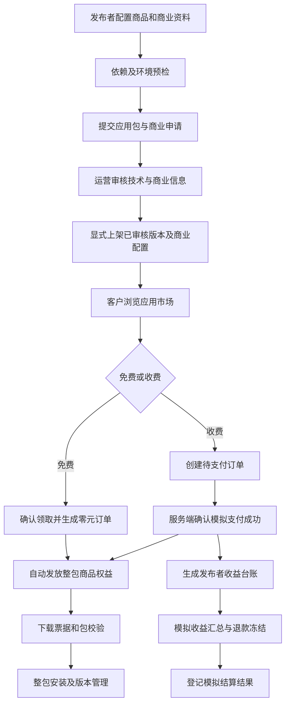

# 应用市场商业化重构计划

> 编制日期：2026-11-16  
> 涉及项目：`E:\OverPorject\yaya-low-code`、`E:\OverPorject\yaya-operation-center`  
> 文档状态：已按 2026-11-16 用户确认的模拟支付范围实施；使用说明见 `application-market-commerce.md`。
> 本期支付复用 AI 员工市场弹窗，仅模拟支付、退款及结算，不接真实支付渠道，不发生资金划转，不执行真实数据清理。原方案中渠道签名、查单、真实支付和打款条目属于后续扩展，不作为本期启用条件。

## 1. 目标与范围

将当前“发布、审核、上架、运营手动授权、客户安装”的分发模式，重构为“发布者配置商品、运营审核上架、客户自主购买、交易成功自动发放权益、客户安装、发布者获得收益”的商业闭环。

保留已实现的单应用／套应用依赖扫描、V3 发布包、不可变发布版本、下载票据及整体安装生命周期。商业化以商品为单位，不拆分套应用成员收费或授权。

本期交付必须同时包含：

- 发布方填写免费／收费、价格及分成相关信息，并随上线申请进入审核。
- 客户在低代码平台市场浏览商品，免费领取或付费购买，查看订单和已购权益。
- 运营端管理商品商业配置、审核、上架、交易、退款、发布者收益及结算台账。
- 交易成功后自动发放整包权益，客户不再依赖运营逐个分配才能安装。
- 在线申请和离线 ZIP 导入遵循相同的商品、审核和销售规则。

## 2. 当前代码核对结论

| 环节 | 当前状态 | 本次改造 |
| --- | --- | --- |
| 发布预检 | 检查依赖、权限和包可移植性 | 复用，并增加商业资料校验 |
| 上线申请 | 没有定价及发布者分成字段 | 增加商业配置申请与审核快照 |
| 审核与上架 | 审核通过后另行选择版本上架 | 保留分离，增加商业配置生效校验 |
| 客户市场 | 已上架商品可见，卡片直接显示安装 | 显示价格、购买状态、购买／领取／安装操作 |
| 应用权益 | 运营手动写入客户商品授权 | 改为购买／领取自动产生权益 |
| 订单 | 未支持应用商品，通用订单要求正金额 | 支持应用订单及零元领取 |
| 支付 | 运营登记回款，AI 员工有测试购买 | 复用 AI 员工支付弹窗，明确模拟支付，不接真实渠道 |
| 分红 | 已有服务商渠道返利 | 新增应用发布者收益，明确与渠道返利的关系 |
| 使用控制 | 主要在下载时校验授权 | 明确买断权益与运行时控制边界 |

主要代码位置：

- 低代码端：`api/src/modules/app_market/`、`web/features/application/components/MarketPublishDialog.tsx`、`web/app/(protected)/market/page.tsx`。
- 运营端：`api/src/application_market.rs`、`api/src/main.rs`、`api/src/licensing.rs`、`web/app/(operation)/application-products/`。

## 3. 业务规则与待确认项

### 3.1 已明确的要求

1. 应用可以免费，也可以收费。
2. 平台客户自行购买或领取；成功获得权益后才能正常下载安装。
3. 发布申请包含定价信息及分成信息。
4. 单应用和套应用统一按整个商品交易、授权及安装。
5. 发布者、购买客户和运营管理者是不同角色，不能将发布者收益等同于渠道服务商返利。
6. 保留审核与上架分离；商品上架后进入客户市场。
7. 不以运营手动分配商品作为正常购买流程。

### 3.2 首期实施基线

| 决策 | 建议 | 影响 |
| --- | --- | --- |
| 收费模式 | 首期免费或一次买断，暂不实现订阅 | 避免未定义到期、续费及停用规则 |
| 币种 | 首期人民币，以整数“分”存储 | 统一支付、退款和分账计算 |
| 权益范围 | 沿用“许可证主体＋商品”；每个客户实例至多安装一份 | 同一主体多实例是否共用购买权益须明确 |
| 后续版本 | 买断默认包含同商品后续兼容版本 | 如需大版本收费，应另行设计升级权益 |
| 分成权限 | 发布者查看平台规则；允许提交分成申请，运营确认最终规则 | 发布者不能自行决定平台实际分成比例 |
| 成交分成 | 按订单冻结的规则和实收金额计算 | 历史交易不受后续规则调整影响 |
| 退款策略 | 首期申请整单退款、运营审核、模拟退款 | 已下载安装后退款的使用约束需明确 |
| 发布者自用 | 开发者源应用继续可用；不自动生成购买收入 | 明确自购是否允许及是否计入分成 |
| 手动赠送 | 如保留，单独作为受控赠送操作 | 必须记录原因与操作人，不伪造购买订单 |
| 结算方式 | 首期模拟收益台账、审核和模拟结算登记 | 未接资金平台时，不承诺自动划款 |

本期不接真实支付渠道、收款账户或打款；不叠加服务商渠道返利或支付手续费。发布者分成按商品申请、运营审核确认，不写死统一比例。冻结收益不参与结算；只登记正向待结算净额，退款负数留待后续抵扣。

## 4. 目标链路

审核通过不自动改变当前售卖版本。上架操作必须选择审核通过的发布版本和商业配置；任何一项不满足条件时拒绝上架。

## 5. 商品与商业配置

### 5.1 分离商品、发布版本和商业配置

- 商品：独立商品 ID、发布主体、平等成员集合及展示资料。
- 发布版本：不可变 release、整包成员、依赖图、资源摘要、包摘要和技术审核结果。
- 商业配置版本：免费／收费、价格、币种、买断范围、分成申请、运营确认规则及商业审核结果。
- 当前上架配置：指向具体发布版本和已审核商业配置。

只调整价格不必重新导出应用结构，但必须形成可追踪的商业配置变更。技术内容未变化时可复用已审核 release，不能覆盖原版本。

### 5.2 建议字段

| 范围 | 字段示例 | 规则 |
| --- | --- | --- |
| 商品展示 | `name`、`description`、`category`、`cover`、`screenshots` | 明确必填项及文件可访问范围 |
| 销售配置 | `pricingMode`、`priceCents`、`currency`、`licenseModel` | 免费价格为 0，收费价格大于 0 |
| 权益说明 | `usageScope`、`upgradePolicy`、`supportDescription` | 向购买客户明确展示 |
| 分成申请 | `requestedRevenueShareBasisPoints`、`revenueShareNote` | 可选，不能直接作为结算依据 |
| 生效规则 | `revenueShareRuleId`、`revenueShareRuleVersion` | 运营确认并在成交时冻结 |

公开商品接口仅返回购买所需信息。发布者分成、收款资料、客户授权名单及完整资源配置不得直接混入公开目录。

## 6. 发布与审核改造

### 6.1 低代码端申请入口

两个上线入口共用发布向导：

1. 展示单应用／套应用范围、完整依赖和阻断项。
2. 填写商品说明、免费／收费、价格及权益说明。
3. 展示分成规则、预计收益；如允许议价，填写分成申请。
4. 确认完整发布内容后提交。

预检指纹继续验证资源快照；另增加商业配置摘要。重试必须使用同一申请 ID、同一包和同一商业快照；任一内容变化都不能覆盖已接收申请。

### 6.2 运营审核

- 审核详情同时展示技术范围、商业配置、分成申请及规则来源。
- 技术审核与商业审核分别记录结果和驳回原因。
- 运营修改价格或分成时保留变更记录，并按约定要求发布者确认，不能静默替换申请条件。
- 上架前检查发布者状态、release 审核状态、商业配置审核状态及有效分成规则。
- 下架停止新交易和新领取；已购客户的下载、升级策略按明确政策处理，不再直接沿用“下架一律禁止下载”的旧行为。

### 6.3 ZIP 导出与运营导入

- 应用 ZIP 继续承载技术包；商业资料作为独立申请元数据，不把运营最终价格或分成规则当作 ZIP 内可信指令。
- 如随包提供商业建议文件，仅作为待审核资料；价格和分成以运营端已审核配置为准。
- 运营导入时选择发布主体、目标商品，补齐销售与分成资料后进入同样的审核流程。
- 导入不能直接赋予客户权益，也不能绕过商业审核直接售卖。

## 7. 客户市场、购买与安装

### 7.1 市场交互

卡片和详情展示商品类型、成员数量、价格、发布方、版本、权益范围及购买状态。

| 客户状态 | 主操作 |
| --- | --- |
| 免费且未领取 | 免费领取 |
| 收费且未购买 | 立即购买 |
| 已有待支付订单 | 继续支付／查看订单 |
| 已购且未安装 | 安装 |
| 已安装 | 打开、更新及安装管理 |
| 权益失效或退款处理后 | 展示具体原因及可执行操作 |

“购买权限”和“安装管理权限”分别控制。买方身份由服务端从平台许可证解析，不接收客户端任意指定客户主体。

### 7.2 免费领取

零元订单不调用支付渠道；领取成功后直接生成已完成订单和有效权益。客户多次点击或网络重试返回相同领取结果，不重复产生有效购买权益。保留领取时间、商品和版本快照，免费订单不生成销售分成。

### 7.3 付费购买

1. 服务端验证客户、商品和当前商业配置，并从服务端读取价格。
2. 生成订单，冻结商品、发布者、release、价格、币种、权益及分成快照。
3. 复用 AI 员工市场支付弹窗，显示成交快照金额及明确的模拟支付说明。
4. 客户点击“测试支付完成”，服务端从许可证取得客户主体，验证订单归属及状态；客户端不传入金额或分成。
5. 在数据库事务内登记模拟回款、完成订单、发放整包权益并写入模拟收益台账；失败整体回滚，重试不重复生效。
6. 客户查询订单结果后执行安装；前端提示不作为授权依据。

同一客户同一商品不能因并发点击重复购买。价格变化后，未支付订单是否继续有效须有明确规则；建议订单在有效期内保留冻结价格。

### 7.4 下载及使用控制

- 安装预检提前检查客户权益，未购时返回可购买状态，避免到下载阶段才失败。
- 签发和核销下载票据时均校验对应权益及允许的下载策略，并保持 release 与包摘要绑定。
- 已购客户下载和升级需与公开上架状态解耦：新客户不能购买已下架商品，历史客户是否可获取已购版本按政策处理。
- 保留整包事务安装、成员 ID 重写、资源冲突检查和自动化默认暂停。
- 首期买断建议不对本地运行持续联网校验；退款、欺诈撤销和订阅停用需要单独的产品规则。
- 不因订单退款或权益撤销自动删除客户业务数据。
- ZIP 导出／导入是发布链路，不能成为绕过购买校验的客户安装入口。

## 8. 订单、支付与退款

### 8.1 状态分离

| 对象 | 建议状态 |
| --- | --- |
| 订单 | `pending_payment`、`paid`、`completed`、`closed`、`partially_refunded`、`refunded` |
| 支付单 | `created`、`pending`、`succeeded`、`failed`、`closed` |
| 交付 | `pending`、`processing`、`succeeded`、`retrying`、`failed` |
| 退款 | `requested`、`approved`、`processing`、`succeeded`、`rejected`、`failed` |

避免用一个订单字段同时表达付款、权益交付和实际安装。支付成功但发放失败的订单进入交付重试，不能要求客户再次付款。

### 8.2 幂等与异常处理

- 对创建订单、免费领取、支付通知、权益发放、收益入账和退款分别设置幂等键及唯一约束。
- 处理订单关闭后的延迟支付通知，进入明确的补偿或退款流程，不能丢弃已收资金。
- 支付渠道调用与本地事务之间使用可恢复的支付／退款尝试记录；外部网络请求不长期占用数据库事务。
- 增加主动查单、交付补偿、退款查询及对账任务。
- 本期明确使用模拟交易接口，所有界面和台账标记模拟；不能将其视为实际收款凭证。真实渠道适配及以下渠道补偿能力留待未来接入时实现。

### 8.3 退款与权益

- 根据退款金额和冻结规则生成收益冲正，不修改原始销售收入记录。
- 只有退款实际成功后才进入对应权益调整；退款处理中是否冻结下载须明确。
- 多个合法权益来源并存时，退款只撤销对应订单来源，不能误撤销赠送或其他有效来源。
- 已结算收入的退款以负向待结算余额或后续抵扣处理，保留完整资金追踪。

## 9. 发布者分成及结算

### 9.1 分成与渠道返利分开建模

分别记录发布者收入、平台收入、支付手续费，以及存在时的渠道返利。规则应明确各项计算基数和先后顺序，避免同一笔钱重复分配。

若平台与发布者为同一主体，应有专门规则，不生成无意义的内部应付账。套应用作为一个商品结算；首期不自动给每个依赖成员应用作者分别分账。涉及多个作者时，发布者必须具备整包销售及依赖分发权；多人分账另行设计。

### 9.2 收益台账

- 收款成功后按订单快照生成收益明细，免费领取不产生销售收益。
- 金额使用整数分，比例使用基点，明确舍入方式、尾差归属及累计退款上限。
- 记录订单、支付、商品、发布主体、规则版本、计提基数、分成金额和可结算时间。
- 通过待结算、冻结、已结算及冲正记录追踪收益，不直接覆盖历史金额。

### 9.3 结算流程

本期按正向待结算净额生成模拟批次，并将相关收益标记为模拟已结算；不打款、不生成银行到账凭证。发布者仅能查看自身收益、结算明细及收款配置。

## 10. 数据模型改造建议

以下是逻辑实体，实施时优先复用现有订单及财务设施，避免无约束地建立第二套财务系统。

| 实体 | 主要用途 |
| --- | --- |
| 应用商品商业配置版本 | 保存价格、权益及分成审核版本 |
| 商业审核记录 | 保存申请、确认、审核及生效历史 |
| 订单／订单行扩展 | 支持 `application` 类型和成交快照、零元订单 |
| 支付单／支付事件 | 渠道交互、回调去重及对账 |
| 交付任务／事务事件 | 支付后可靠发放权益及补偿 |
| 应用权益来源记录 | 追踪购买、免费领取、赠送及历史授权 |
| 应用有效权益 | 聚合客户当前有效获取范围，复用并扩展现有权益表 |
| 发布者收益规则版本 | 管理生效比例及分配方式 |
| 收益及冲正明细 | 不可变收入、冻结和退款调整 |
| 退款单／退款事件 | 渠道退款与权益、收益联动 |
| 发布者结算批次／明细 | 关联收益、打款及对账结果 |

关键约束：订单幂等键、渠道交易号、支付事件、权益来源和收益事件均不可重复生效；金额和状态转换必须由服务端验证。

## 11. 接口与模块边界

接口名称为建议，实施时统一更新 OpenAPI、生成客户端、两端类型及 BFF。

| 领域 | 建议能力 |
| --- | --- |
| 发布 | 预检、提交商业资料、读取审核结果、商业变更申请 |
| 客户目录 | 商品列表／详情、当前价格、本人购买及权益状态 |
| 客户交易 | 免费领取、创建订单、读取自己的订单、发起支付、关闭未付订单 |
| 退款 | 客户退款申请、运营审核、渠道退款及状态查询 |
| 支付渠道 | 经签名验证的支付／退款通知、主动查单 |
| 权益 | 本人已购商品、安装预检、下载与交付补偿 |
| 运营 | 商业审核、显式上架、商品订单、退款及异常交付管理 |
| 发布者 | 自身商品销售、收益、结算和收款资料 |

低代码端模块建议分为发布、商品目录、交易、权益和安装；运营端分为商品、商业审核、交易支付、权益交付和收益结算。不要继续把商业逻辑集中加入单个市场文件或 `main.rs`。

## 12. 两端页面改造

### 12.1 低代码平台

- 发布向导：增加商品介绍、定价、分成规则及确认步骤。
- 市场目录／详情：增加免费或价格展示、购买状态和权益说明。
- 收银台／支付结果：展示订单金额、支付方式、有效期及明确的交付状态。
- 我的订单／已购应用：查询付款、领取、权益、安装及退款进度。
- 发布者中心：查看自己的审核、商品销售、收益与结算。

### 12.2 运营平台

- 应用管理：展示当前售卖版本、商业配置、价格、发布主体和分成规则。
- 审核详情：技术与商业信息并列，提供独立审核记录。
- 订单及财务：支持应用订单、支付状态、交付状态、退款及异常重试。
- 发布者收益：销售收益、可结算金额、冻结、冲正和结算批次。
- ZIP 导入：补齐商业配置并进入审核。
- 原商品授权弹窗：退出正常获取主流程；如保留赠送入口，增加原因、审计及来源标识。

## 13. 存量数据与上线策略

1. 仅新增迁移和必要回填，不自动清理商品、安装、客户业务数据或财务历史。
2. 现有商品进入“待配置商业信息”，不得默认为收费商品，也不得把缺失价格自动视为免费。
3. 既有手动授权标记为 `legacy_grant`，保留来源和历史权益，不伪造已支付订单。
4. 已安装应用继续保留；对历史安装与权益不一致生成核对清单，不自动停用或删除。
5. 对现有免费／已购／赠送权益的认定由维护者显式确认后回填。
6. 先补齐并审核商业资料，再显式上架以开放免费领取或模拟购买。
7. 本期收费商品走用户明确要求的模拟购买，界面持续显示模拟标识；未来真实支付另行实施和验收。
8. 回退时停止新交易并保留支付回调、查单、交付补偿和退款能力，不能让已收款订单无人处理。

## 14. 实施阶段与交付门槛

| 阶段 | 工作 | 交付门槛 |
| --- | --- | --- |
| P0：规则与设计 | 确认第 3 节决策、模拟支付范围、模型、状态机及接口契约 | 形成可实施的商业规则及数据设计 |
| P1：商品与审核 | 商业配置版本、发布向导、运营审核、上架关联 | 两种发布入口均可提交并审核完整商业资料 |
| P2：免费交易 | 零元订单、权益来源、已购目录、安装前置校验 | 客户无需运营分配即可免费领取并整包安装 |
| P3：付费交易 | 复用支付弹窗、模拟回款、订单及事务交付 | 模拟支付成功自动授权，重试不重复交付 |
| P4：收益与退款 | 分成快照、台账、退款、冲正、结算及发布者中心 | 订单、退款、收益和结算可追踪且金额一致 |
| P5：联调与上线 | 两端端到端测试、存量核对、灰度及回退演练 | 免费、收费及异常补偿全链路验收通过 |

P3 和 P4 共同构成本期模拟商业闭环。真实支付渠道、查单、补偿及资金结算属于后续独立范围；本期不收取实际款项。

## 15. 测试与验收

### 15.1 商品和审核

- 免费价格非零、收费价格非正、非法币种及越权修改必须拒绝。
- 商业变更不修改既有 release，也不改变历史订单。
- 审核通过不上架；上架后其他有效平台客户能看到商品及正确价格。
- 发布者、购买者、运营和财务的数据访问相互隔离。
- 在线申请与 ZIP 导入执行相同的商业规则。

### 15.2 免费与付费

- 新客户免费领取后自动获得权益并安装套应用，无运营手动授权步骤。
- 未购收费商品不能下载安装；购买成功后自动授权。
- 客户篡改价格、主体、分成或支付状态均不能生效。
- 并发下单、重复领取、重复模拟支付和重复交付不产生重复权益或收益。
- 模拟支付事务失败时回滚全部回款、权益及收益，可重试；关闭的订单不得支付。
- 本期回款与交付在同一个事务完成，不出现半笔模拟成交；真实收款后的跨系统补偿留待渠道接入。

### 15.3 收益与退款

- 按成交快照计算金额，后续改价或改分成不影响旧单。
- 验证最小金额、舍入、整单退款、重复退款及已结算后退款；部分退款不在本期范围。
- 免费订单不计销售分成；渠道返利和发布者收入不重复分配。
- 退款不误撤其他有效权益，不自动删除客户业务数据。
- 模拟结算登记与实际银行到账明确区分，本期不创建真实打款记录。

### 15.4 跨端和回归

- 从发布实例提交 A→B→C 套应用，经商业审核上架，在全新客户实例完成购买及安装。
- 验证关联表单、自动化、按钮和流程全部指向新本地资源。
- 验证改价、上架版本切换、下架、重新上架、已购下载及升级范围。
- 回归已有 AI 员工、平台许可证、服务商返利、订单和财务功能。
- 执行相关 Rust 测试、两端类型检查、前端流程测试和隔离环境端到端测试。
- 支付沙箱和测试数据与生产隔离；未经明确授权不创建真实收费、退款或打款。

## 16. 完成定义

只有同时满足以下条件，才能认为应用市场商业化闭环完成：

1. 发布者能提交完整技术与商业资料，运营能审核并显式上架。
2. 客户能看见免费／收费及明确权益，自主领取或模拟购买。
3. 成功交易自动产生权益，客户能够整包安装，无需运营分配。
4. 订单、支付、权益、收益、退款与结算能相互追溯并正确对账。
5. 存量授权和客户安装得到保留，既有非应用市场业务不受破坏。

